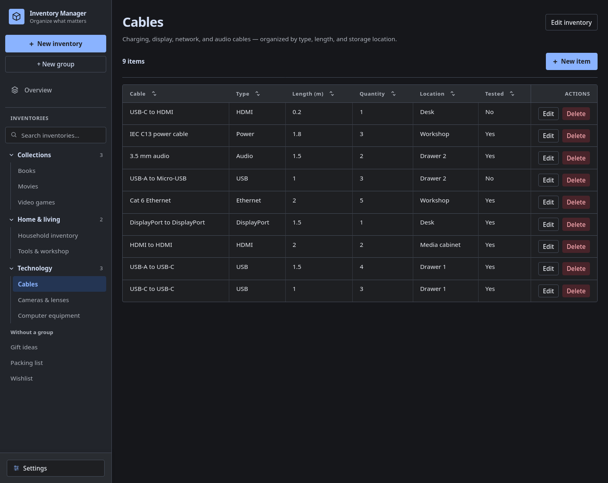

# Inventory Manager

> This project is currently under development. The interface, field configuration, and application behavior may change as development progresses.

Inventory Manager is a local application for flexible management of personal inventories.

Users can create inventory lists, define custom fields, and manage items with typed values. Each inventory has its own field configuration, including text limits and options for select and multiselect fields.

A responsive sidebar provides direct access to inventories, while tables and dialogs support configuration and item management.



The screenshot uses synthetic demo data.

## Current features

- Inventory lists with custom fields and typed items
- Managed file attachments with download links and optional image previews
- ZIP inventory import/export including attached files
- Reusable inventory structure templates
- Single-level groups with drag-and-drop organization
- Sidebar filtering by inventory title
- Sortable item tables
- Inventory-local text search across all fields and combinable, type-aware filters
- Direct cell editing with atomic saving and conflict protection
- Per-inventory table views with column visibility, automatic/manual widths, and text wrapping
- Required fields, per-column sorting controls, and drag-and-drop field ordering
- Configurable text limits, selection options, web links, and automatic numbering
- English and German interface
- Light, dark, and system appearance modes with accent colors

## Getting started

Create an inventory from the sidebar, optionally choosing a template, its included fields, and a group. Use the **Inventory settings** gear beside its title to define fields and selection options or save its structure as a template. Save the configuration and add items with **New item**. Drag inventories onto sidebar groups to organize them. Right-click an inventory to export a ZIP with its saved entries and files; use the import icon beside **New inventory** to check an archive and create an independent copy.

Click a column heading to cycle through ascending, descending, and original order. Use **View** to show or hide columns, wrap text, toggle image previews for file columns, or restore automatic widths. Drag a heading's right edge to resize a column; right-click the heading to restore its automatic width or hide it. Table preferences are saved with each inventory. Use search and filters to narrow items, or the pencil to edit cells and save or discard changes together.

Open **Settings** at the bottom of the sidebar to change language, appearance, and accent color. **Templates** directly above it lets you edit or delete saved structures.

## Fields and item values

| Field type      | Purpose                                                           |
| --------------- | ----------------------------------------------------------------- |
| Text            | Text with a limit of 1–1,000 characters, defaulting to 255        |
| Number          | Whole or decimal numbers                                          |
| Yes/No          | A boolean value displayed as yes or no                            |
| Checkbox        | A checkbox that can be toggled directly in the item table         |
| Date            | A calendar date                                                   |
| Time            | A time of day                                                     |
| Date and time   | A calendar date with a time                                       |
| Duration        | Hours, minutes, and seconds, stored as whole seconds              |
| Single choice   | One option from this field's selection options                    |
| Multiple choice | Several options from this field's selection options               |
| URL             | An HTTP or HTTPS address with optional link text                  |
| Files           | Managed copies of one or more files; click a filename to download |
| Automatic ID    | A read-only number assigned automatically to each item            |

Selection options belong to their field within one inventory. Item dialogs use themed dropdowns for single and multiple choices. Web links open in a new tab; without link text, the address is displayed.

Required fields must be completed for new items and when saving existing items. Adding a required field leaves existing entries unchanged until their next edit. If a table checkbox cannot be saved because required or other input is incomplete, the edit dialog opens with the checkbox change still unsaved. Canceling discards it.

Automatic IDs have independent counters per field and inventory, starting at 1. Adding an ID field numbers existing active items by creation time, with technical IDs breaking ties. Numbers are assigned only when a save succeeds and remain unchanged during item edits. Deleted numbers are not reused unless explicitly enabled in the field settings; that option selects the smallest free number.

## Technology

The frontend uses React, TypeScript, Vite, and Tailwind CSS. The Express/TypeScript backend stores data locally in SQLite through Drizzle, with database migrations and rotating log files.

## Development

Node.js 24 or later and npm are required. Install each package from the repository root:

```bash
npm ci
npm --prefix backend ci
npm --prefix frontend ci
```

The packages retain independent lockfiles. `better-sqlite3` is a native dependency; its installation must complete successfully before running the backend. See [backend documentation](backend/README.md).

Start the backend and frontend in separate terminals:

```bash
npm run dev:backend
```

```bash
npm run dev:frontend
```

The backend defaults to `http://127.0.0.1:8000`; the Vite frontend usually runs at `http://localhost:5173`. Verify backend readiness at `/health`. The backend applies Drizzle migrations before listening, creating an empty database on first startup.

For a compiled backend:

```bash
npm --prefix backend run build
npm --prefix backend start
```

API documentation remains available at `http://127.0.0.1:8000/docs`, with the API contract at `/openapi.json` and an alternative view at `/redoc`.

## Configuration and local data

Copy `backend/.env.example` to `backend/.env` to customize the backend. The development, start, and migration commands load that optional file using Node's built-in environment support. Existing process environment variables take precedence.

| Variable              | Purpose                                                             |
| --------------------- | ------------------------------------------------------------------- |
| `INVENTORY_DATA_DIR`  | Absolute storage root, default repository-relative `InventoryData/` |
| `INVENTORY_DB_PATH`   | Absolute database path, default `<storage root>/data/inventory.db`  |
| `INVENTORY_HOST`      | Bind address, default `127.0.0.1`                                   |
| `INVENTORY_PORT`      | Backend port, default `8000`                                        |
| `INVENTORY_LOG_LEVEL` | Application log level, default `INFO`                               |
| `VITE_API_BASE_URL`   | Frontend backend URL, default `http://127.0.0.1:8000`               |

Configure the frontend through `frontend/.env`, based on `frontend/.env.example`. Backend storage paths support `~/` and are independent of the current working directory. The backend permits requests from `http://localhost:5173` and `http://127.0.0.1:5173`.

The frontend initially selects German for a `de` system locale and English for all other locales. Language, appearance, accent color and file-warning choices are stored in `config/settings.json`; inventory views are stored in SQLite. The system appearance option follows the operating system's light or dark preference, including changes while the application is open. Inventory groups and their assigned inventories are stored in SQLite.

```text
InventoryData/
├── config/
│   └── settings.json
├── data/
│   ├── inventory.db
│   └── attachments/
├── backups/
├── logs/
└── temp/
```

This storage root is excluded from version control and initialized at startup. Running from the repository keeps runtime files here; data and attachments are separate from backup storage, logs and temporary archive files. The interface loads versioned preferences before editing is available and reports failed saves or conflicting changes with retry/reload actions. Settings > Storage locations lets you choose data and backup folders or restore their defaults. Existing files move after confirmation, without restarting the application. See the [backend storage configuration](backend/README.md#stored-locations).

See [backend documentation](backend/README.md) for migration commands and API behavior.

## Quality checks

Run the complete quality check from the repository root:

```bash
npm run check
```

It executes typecheck, lint, tests, build, and finally `prettier --check .`. The format check only reads files. The other checks delegate to the frontend and backend packages; backend tests use `node:test`, frontend tests use Vitest.

Tests use synthetic data. The frontend client integration test starts Express with a temporary database and local port. HTTP tests require an environment permitting local socket communication.

Individual checks remain available in each package, for example:

```bash
npm --prefix backend run test
npm --prefix frontend run test
npm run format:check
```

## License

This project is licensed under the MIT License. See the [LICENSE](LICENSE) file for details.
